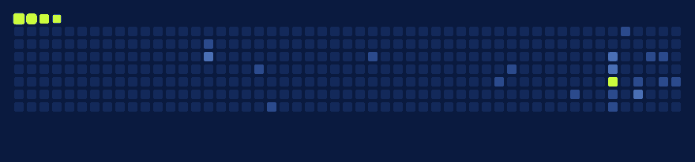

<!-- Palette: navy #0A1A3F · deep blue #1B3A8C · white #FFFFFF · lime accent #CCFC3D -->

---

### 👨‍💻 About me

I'm an AI student and enthusiast pursuing a **Bachelor's degree in Artificial Intelligence** at the **Federal University of Jataí (UFJ)**, Brazil. My biggest ambition is to **build real-world solutions that genuinely make a difference in people's lives**.

- 🎓 2nd semester · B.Sc. in Artificial Intelligence @ UFJ
- 🌱 Currently learning **SQL** and **Pandas**
- 🌎 Languages: **Portuguese** (native) · **English** (advanced)
- ⚡ **Fun fact:**

### 🚀 What I'm working on

- 📱 **Habit-breaking app:** a mobile app that helps people quit addictions and build healthier routines
- 🗳️ **Election tracker:** a website that follows vote counts in real time, with **prediction models** and **interactive maps**

### 🛠️ Tech Stack

**Languages**

  
  
  
  

**Data & AI**

  
  
  

**Tools**

  
  

### 📊 GitHub Stats

  
  

### 🐍 Contribution Snake

  

### 🤝 Connect with me

  
  
  

